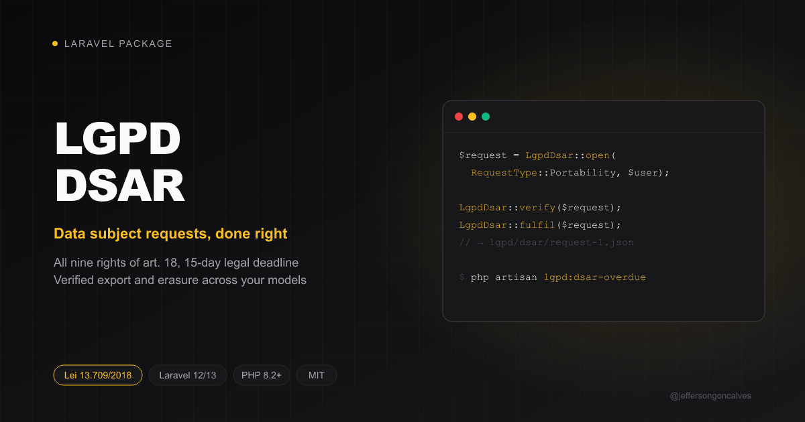

# Laravel LGPD DSAR



[](https://packagist.org/packages/jeffersongoncalves/laravel-lgpd-dsar)
[](https://github.com/jeffersongoncalves/laravel-lgpd-dsar/actions/workflows/tests.yml)
[](https://packagist.org/packages/jeffersongoncalves/laravel-lgpd-dsar)

Handles data subject requests under the Brazilian General Data Protection Law (LGPD, Lei 13.709/2018, art. 18), using the data you declared with [laravel-lgpd](https://github.com/jeffersongoncalves/laravel-lgpd):

- tracks each request: its type (all nine rights of art. 18, I–IX), status, and the legal deadline (15 days by default, art. 19, II);
- requires an **identity check** before any export or erasure;
- **exports** every piece of personal data of the subject, from all your models, as JSON on a private disk (access and portability);
- **erases** the subject's data by applying each column's anonymize strategy. Columns marked `Keep` are left untouched (legal retention, art. 16);
- fires an event for every request past its deadline, so you can alert your DPO (encarregado).

> This package gives you tooling. It does not make you compliant on its own. You still need legal review, for example to decide which requests you can reject and why.

## Installation

```bash
composer require jeffersongoncalves/laravel-lgpd-dsar
php artisan vendor:publish --tag="lgpd-dsar-migrations"
php artisan migrate
php artisan vendor:publish --tag="lgpd-dsar-config"
```

## Locating a subject's data

Models listed in `lgpd.models` (see [laravel-lgpd](https://github.com/jeffersongoncalves/laravel-lgpd)) are searched for the subject's records:

- the subject's own model (e.g. `User`) is found without extra code;
- every other model says how to find the records that belong to a subject:

```php
use JeffersonGoncalves\LgpdDsar\Contracts\ResolvesDataSubject;

class Order extends Model implements HasPersonalData, ResolvesDataSubject
{
    use InteractsWithPersonalData;

    public static function dataSubjectQuery(Model $subject): Builder
    {
        return static::query()->where('user_id', $subject->getKey());
    }
}
```

A model that does not implement `ResolvesDataSubject` is skipped.

## Usage

```php
use JeffersonGoncalves\LgpdDsar\Enums\RequestType;
use JeffersonGoncalves\LgpdDsar\Facades\LgpdDsar;

// 1. Open: from a logged-in user, or from a contact form (subject unknown yet)
$request = LgpdDsar::open(RequestType::Portability, $user);
$request = LgpdDsar::open(RequestType::Deletion, requester: ['name' => 'Maria', 'email' => 'maria@example.com']);

// 2. Verify the requester's identity, linking the subject if needed
LgpdDsar::verify($request, $user);

// 3a. Access / portability / anonymization / deletion run automatically
LgpdDsar::fulfil($request, 'Your data is attached.');
$request->export_path; // lgpd/dsar/request-1.json on the configured disk

// 3b. Other rights (confirmation, correction, sharing, consent info/revocation): handle them yourself, then:
LgpdDsar::complete($request, 'Your address was corrected.');
LgpdDsar::reject($request, 'Data kept to meet a legal obligation (art. 16, I).');
```

Lower-level helpers: `LgpdDsar::export($user)`, `LgpdDsar::exportToFile($user, 'file.json')`, `LgpdDsar::erase($user)`. `erase` runs inside a transaction.

### Events

| Event | When |
|---|---|
| `DataSubjectRequestOpened` | a request is opened. Use it to confirm receipt to the requester |
| `DataSubjectRequestClosed` | a request is completed or rejected. Use it to notify the requester, sending the export as needed |
| `DataSubjectRequestOverdue` | `lgpd:dsar-overdue` found an open request past its deadline |

Schedule the deadline check:

```php
Schedule::command('lgpd:dsar-overdue')->daily();
```

## Testing

```bash
composer test
```

## Changelog

See [CHANGELOG](CHANGELOG.md).

## License

The MIT License (MIT). See [License File](LICENSE.md).
